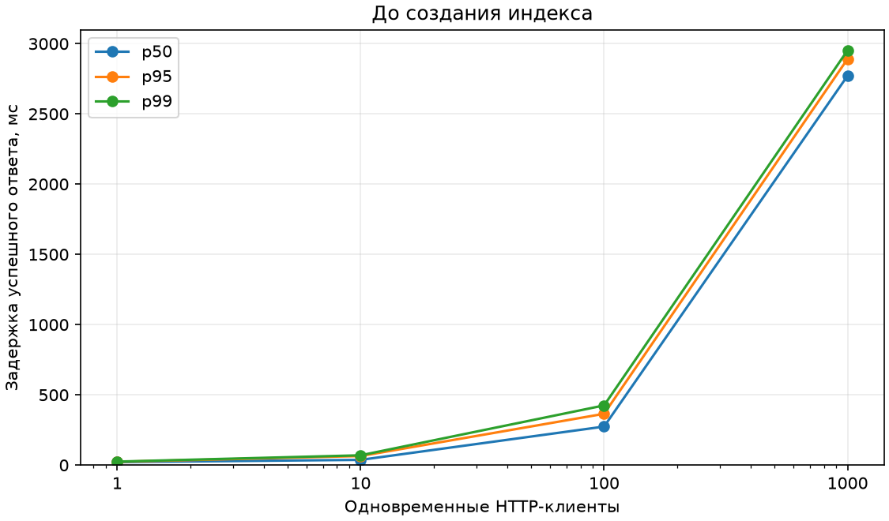
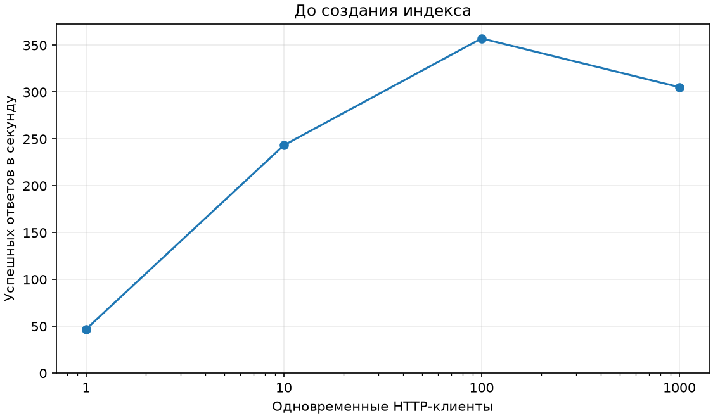
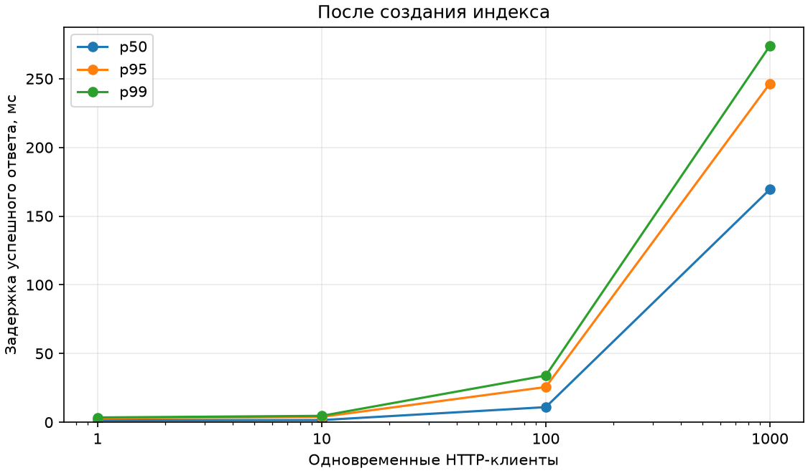
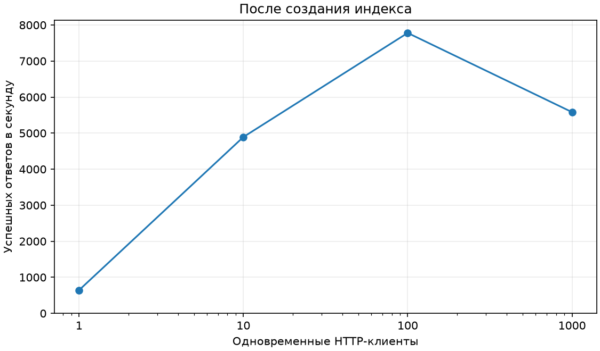

# ДЗ №2. Производительность индексов

Эксперимент выполнен 25 ноября 2026 года на `GET /user/search` с помощью Grafana k6 2.4.0. Сравнивались два состояния одной таблицы из 1 000 000 анкет. В базовой серии действовал индекс первичного ключа `users_pkey`. Во второй серии добавлен составной индекс поиска.

При 1000 клиентах p95 снизился с 2 890,75 до 246,48 мс. Throughput вырос с 305,26 до 5 583,18 успешного ответа в секунду. Всего зарегистрировано 0 ошибок.

## Данные

Использован [CSV OTUS](https://raw.githubusercontent.com/OtusTeam/highload/master/homework/people.v2.csv). Опубликованный файл содержит 999 930 полных строк и оборванную последнюю строку. До 1 000 000 строк добавлены 70 анкет, выбранных с возвращением из полного набора с `seed=42`. Порядок строк перемешан, каждой анкете присвоен отдельный UUID. Частоты имён и фамилий сохранены с поправкой на дополнительные 0,007% записей. В загруженном наборе 138 различных имён и 1006 различных фамилий. Дата рождения и город взяты из CSV.

| Префикс имени | Префикс фамилии | Строк по имени | Строк по фамилии | Строк по обоим |
| --- | --- | ---: | ---: | ---: |
| Алек | Иван | 57 378 | 23 537 | 1 388 |
| Дми | Кузне | 17 846 | 16 573 | 293 |
| Конст | Оси | 7 987 | 4 036 | 27 |

Версия среды, контрольная сумма набора и настройки PostgreSQL сохранены в [dataset.json](dataset.json). Импорт выполнен в локальную базу `app_tests_k6` через `COPY` с последующим `VACUUM ANALYZE`.

## Методика

- PostgreSQL 17.12 в Podman, ASP.NET Core API из Release-сборки и Grafana k6 2.4.0 на Windows. API и k6 запущены на одном хосте, HTTP через loopback. Пул Npgsql ограничен 64 соединениями. Автоматическая подготовка SQL-запросов отключена.
- [Сценарий k6](../../scripts/search-k6.js) использует исполнитель `ramping-vus`. Выполнено по одному замеру на 1, 10, 100 и 1000 виртуальных пользователей до и после индекса. Каждый виртуальный пользователь отправляет новый запрос после завершения предыдущего. Используется HTTP keep-alive. Три пары префиксов назначаются по кругу по номеру итерации.
- За 5 секунд k6 поднимает число виртуальных пользователей до цели, затем 3 секунды прогревает API и PostgreSQL при целевой нагрузке. Далее начинается 15-секундное окно замера при том же числе виртуальных пользователей. Все три этапа выполняются в одном процессе k6 с переиспользованием соединений. Таймаут HTTP-запроса составляет 15 секунд. Начатым итерациям отведено до 16 секунд на завершение после конца окна.
- Задержка успешных запросов измерена по `response.timings.duration`. Эта метрика включает отправку запроса, ожидание и получение тела ответа. Установка соединения учитывается k6 отдельно. Перцентили p50, p95 и p99 вычисляет k6. Throughput равен числу завершённых HTTP 200 без ошибки транспорта, делённому на длительность измерительного окна с учётом завершения последнего запроса. Остальные ответы и ошибки транспорта учтены в столбце «Ошибки».
- Python оркестрирует загрузку данных, запуск API и k6, применение индекса и сохранение планов. Matplotlib строит графики по сохранённым метрикам. [Документация исполнителей k6](https://grafana.com/docs/k6/latest/using-k6/scenarios/executors/) · [Документация метрик k6](https://grafana.com/docs/k6/latest/using-k6/metrics/reference/)
- SQL-планы получены через `EXPLAIN (ANALYZE, BUFFERS)` с литералами для тех же шаблонов, проекции и порядка. `Execution Time` отражает выполнение на сервере PostgreSQL. HTTP-замер также включает ожидание соединения из пула Npgsql, сериализацию и передачу результата.

## До создания индекса





## После создания индекса





| Серия | Клиенты | Длительность, с | HTTP 200 | Ошибки | Успешных ответов/с | p50, мс | p95, мс | p99, мс |
| --- | ---: | ---: | ---: | ---: | ---: | ---: | ---: | ---: |
| До | 1 | 15,01 | 705 | 0 | 46,96 | 21,05 | 23,19 | 24,67 |
| До | 10 | 15,04 | 3 660 | 0 | 243,27 | 37,14 | 64,32 | 69,67 |
| До | 100 | 15,20 | 5 432 | 0 | 357,27 | 274,07 | 365,09 | 424,66 |
| До | 1000 | 17,82 | 5 440 | 0 | 305,26 | 2 771,18 | 2 890,75 | 2 952,02 |
| После | 1 | 15,00 | 9 651 | 0 | 643,36 | 1,40 | 2,72 | 3,47 |
| После | 10 | 15,00 | 73 395 | 0 | 4 892,35 | 1,57 | 3,91 | 4,64 |
| После | 100 | 15,01 | 116 804 | 0 | 7 780,19 | 10,99 | 25,61 | 33,95 |
| После | 1000 | 15,14 | 84 507 | 0 | 5 583,18 | 169,46 | 246,48 | 273,94 |

Сводные метрики сохранены в [metrics.json](metrics.json), исходные сводки k6 по восьми прогонам — в [k6-summaries.json](k6-summaries.json).

## Индекс

```sql
CREATE INDEX IF NOT EXISTS users_search_prefix_idx
ON users USING btree (second_name varchar_pattern_ops, first_name varchar_pattern_ops);
```

`LIKE 'префикс%'` задаёт диапазон по началу строки. `varchar_pattern_ops` задаёт посимвольный порядок ключей для префиксного поиска при локали `en_US.utf8`. В PostgreSQL 17 ведущий диапазон составного B-tree ограничивает сканируемую часть индекса. Диапазон по второму ключу дополнительно отбирает записи внутри неё. Ведущим ключом выбрана фамилия, поскольку во всех трёх измеренных парах её префикс уже префикса имени по числу совпадений. [Классы операторов PostgreSQL 17](https://www.postgresql.org/docs/17/indexes-opclass.html) · [Составные индексы PostgreSQL 17](https://www.postgresql.org/docs/17/indexes-multicolumn.html)

Индекс упорядочен по фамилии и имени. Результаты из нескольких диапазонов этих ключей требуют отдельной сортировки по `id`. Добавление `id` третьим ключом сохраняет группировку по фамилии и имени и не устраняет эту сортировку. Файл DDL расположен в [002_users_search_prefix.sql](../../infrastructure/sql/002_users_search_prefix.sql).

## Планы выполнения

| Префиксы | Строк | Execution Time до, мс | Execution Time после, мс | Shared hit + read до | Shared hit + read после |
| --- | ---: | ---: | ---: | ---: | ---: |
| Алек / Иван | 1 388 | 27,632 | 4,716 | 14 328 | 1 345 |
| Дми / Кузне | 293 | 22,451 | 1,403 | 14 328 | 310 |
| Конст / Оси | 27 | 20,612 | 0,354 | 14 328 | 37 |

До индекса каждый план использует `Parallel Seq Scan`, сортировку и `Gather Merge`. Для запроса `Конст / Оси` три участника сканирования обрабатывают таблицу, после фильтра остаётся 27 строк. После создания индекса `Bitmap Index Scan` получает адреса 27 строк, используя диапазоны по обоим префиксам. `Bitmap Heap Scan` читает 27 страниц таблицы и проверяет исходные условия `LIKE`. `Sort` упорядочивает результат по UUID. В `BUFFERS` у верхнего узла отражена совокупная работа плана с буферами. Суммирование верхнего узла с дочерними привело бы к двойному учёту.

Полные планы для всех сценариев сохранены в [before-plans.txt](before-plans.txt) и [after-plans.txt](after-plans.txt). [Размеры индексов](sizes.txt) измерены после эксперимента.

## Интерпретация результатов

Без индекса при росте параллелизма со 100 до 1000 throughput изменился с 357,27 до 305,26 успешного ответа в секунду. p95 вырос с 365,09 до 2 890,75 мс.

С индексом наибольший throughput составил 7 780,19 успешного ответа в секунду при 100 виртуальных пользователях. При переходе со 100 до 1000 пользователей throughput снизился с 7 780,19 до 5 583,18, а p95 вырос с 25,61 до 246,48 мс. Пробный запуск сразу с 1000 виртуальных пользователей вызвал массовые отказы TCP. Его результаты исключены. В обеих итоговых сериях использован одинаковый плавный набор нагрузки. Эксперимент измеряет общий эффект под нагрузкой. Для определения вклада пула соединений, сериализации и клиента требуются отдельные измерения.

Результаты относятся к трем указанным парам префиксов, локальному стенду и одному прогону на уровень. Межпрогонный разброс и холодный кеш не измерялись. При выборе индекса для нагрузки с другими префиксами требуется заново оценить селективность. Индекс также занимает место и обслуживается при записи. Нагрузка на запись в эксперименте не измерялась.

## Воспроизведение

Команды подготовки и запуска приведены в [README проекта](../../README.md#дз-2---производительность-индексов). Скрипт проверяет число анкет и наличие только первичного индекса перед базовым замером. Нагрузочный клиент — Grafana k6 для Windows. Для запуска k6 Java не требуется.
