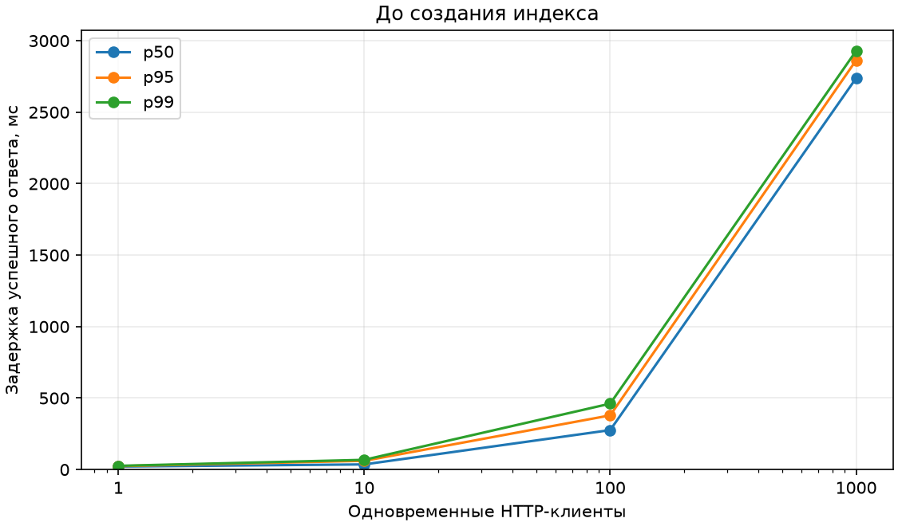
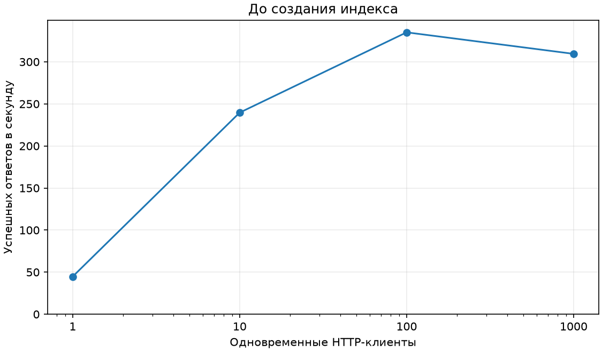
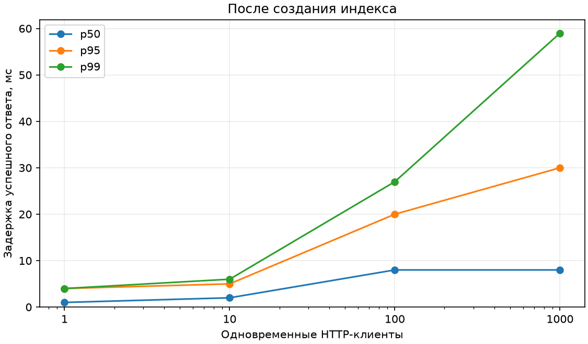
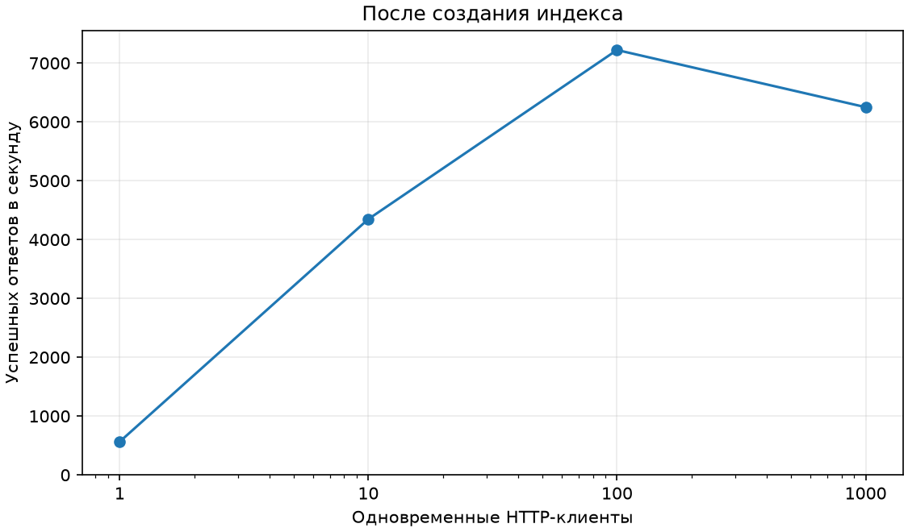

# ДЗ №2. Производительность индексов с Apache JMeter

Эксперимент выполнен 26 ноября 2026 года на `GET /user/search`. Нагрузку создавал Apache JMeter 5.6.3 под OpenJDK 17 в WSL Ubuntu. На одной таблице из 1 000 000 анкет сравнивались два состояния. В первом действовал первичный индекс по UUID. Во втором добавлен составной B-tree.

При 1000 потоках p95 снизился с 2 863 до 30 мс, а throughput вырос с 309,47 до 6 250,42 успешного ответа в секунду. Всего в восьми замерах зарегистрировано 0 ошибок.

## Данные

Использован [CSV OTUS](https://raw.githubusercontent.com/OtusTeam/highload/master/homework/people.v2.csv). Опубликованный файл содержит 999 930 полных строк и оборванную последнюю строку. До 1 000 000 строк добавлены 70 анкет, выбранных с возвращением из полного набора с `seed=42`. Порядок строк перемешан, каждой анкете присвоен отдельный UUID. Частоты имён и фамилий сохранены с поправкой на дополнительные 0,007% записей. В загруженном наборе 138 различных имён и 1006 различных фамилий. Дата рождения и город взяты из CSV.

| Префикс имени | Префикс фамилии | Строк по имени | Строк по фамилии | Строк по обоим |
| --- | --- | ---: | ---: | ---: |
| Алек | Иван | 57 378 | 23 537 | 1 388 |
| Дми | Кузне | 17 846 | 16 573 | 293 |
| Конст | Оси | 7 987 | 4 036 | 27 |

Версия среды, контрольная сумма набора и настройки PostgreSQL сохранены в [dataset.json](dataset.json). Импорт выполнен в локальную базу `app_tests_jmeter` через `COPY` с последующим `VACUUM ANALYZE`.

## Методика

- PostgreSQL 17 в Podman. Release API работает на Windows и доступен из Ubuntu через виртуальный интерфейс WSL. Пул Npgsql ограничен 64 соединениями. Автоматическое выполнение `PREPARE` отключено.
- [Тест-план JMeter](../../../scripts/search-jmeter.jmx) содержит одну `Thread Group` и три `HTTP Request`. Каждый поток повторяет три GET-запроса с разными парами префиксов. Используется HTTP keep-alive.
- Выполнено по одному прогону при 1, 10, 100 и 1000 потоках в каждой серии. JMeter поднимает число потоков за 5 секунд. Группа настроена на 23 секунды. При подключении установлен таймаут 3 секунды, при чтении ответа — 15 секунд.
- Окно отбора начинается через 8 секунд после первого сэмпла и длится 15 секунд. Старт группы JMeter может предшествовать первому сэмплу, поэтому фактическая выдача запросов может закончиться чуть раньше конца окна. Максимум `grpThreads` в сэмплах окна соответствует целевому числу потоков во всех замерах.
- Задержка представлена полем JMeter `elapsed` для успешных HTTP 200. Оно измеряет полное время запроса. Поле `Latency` в JTL отражает время до начала получения ответа. p50, p95 и p99 рассчитаны методом ближайшего ранга. Throughput равен числу успешных ответов, делённому на длительность окна с учётом завершения запросов, начатых в этом окне. [Руководство Apache JMeter](https://jmeter.apache.org/usermanual/get-started.html)
- Планы SQL получены через `EXPLAIN (ANALYZE, BUFFERS)` для тех же фильтров, проекции и порядка. Показатель `Execution Time` измеряет выполнение на PostgreSQL. HTTP-задержка также включает работу API и передачу результата.

## Графики latency до индекса



## Графики throughput до индекса



## Графики latency после индекса



## Графики throughput после индекса



## Сводные результаты

| Серия | Потоки | Длительность, с | HTTP 200 | Ошибки | Успешных ответов/с | p50, мс | p95, мс | p99, мс |
| --- | ---: | ---: | ---: | ---: | ---: | ---: | ---: | ---: |
| До | 1 | 15,00 | 671 | 0 | 44,73 | 21 | 24 | 26 |
| До | 10 | 15,00 | 3 594 | 0 | 239,60 | 36 | 61 | 68 |
| До | 100 | 15,18 | 5 084 | 0 | 335,02 | 276 | 379 | 461 |
| До | 1000 | 17,66 | 5 465 | 0 | 309,47 | 2738 | 2863 | 2929 |
| После | 1 | 15,00 | 8 454 | 0 | 563,60 | 1 | 4 | 4 |
| После | 10 | 15,00 | 65 207 | 0 | 4 347,13 | 2 | 5 | 6 |
| После | 100 | 15,00 | 108 330 | 0 | 7 222,00 | 8 | 20 | 27 |
| После | 1000 | 15,01 | 93 800 | 0 | 6 250,42 | 8 | 30 | 59 |

[Сводные метрики](metrics.json) и [архив восьми JTL из измерительного окна](jmeter-jtl.zip).

## Запрос добавления индекса

```sql
CREATE INDEX IF NOT EXISTS users_search_prefix_idx
ON users USING btree (second_name varchar_pattern_ops, first_name varchar_pattern_ops);
```

## EXPLAIN запросов после индекса

| Префиксы | Строк | Execution Time до, мс | Execution Time после, мс | Shared hit + read до | Shared hit + read после |
| --- | ---: | ---: | ---: | ---: | ---: |
| Алек / Иван | 1 388 | 23,827 | 4,349 | 14 328 | 1 345 |
| Дми / Кузне | 293 | 21,536 | 1,550 | 14 328 | 310 |
| Конст / Оси | 27 | 21,610 | 0,452 | 14 328 | 37 |

До индекса PostgreSQL использовал `Parallel Seq Scan`. После создания индекса `Bitmap Index Scan` использует диапазоны по обоим префиксам, `Bitmap Heap Scan` получает строки таблицы, а `Sort` сортирует их по UUID. Полный вывод сохранён в [before-plans.txt](before-plans.txt) и [after-plans.txt](after-plans.txt). [Размеры индексов](sizes.txt).

## Объяснение, почему индекс именно такой

`LIKE 'префикс%'` задаёт диапазон по началу строки. `varchar_pattern_ops` задаёт посимвольный порядок ключей для префиксного поиска при локали `en_US.utf8`. В PostgreSQL 17 ведущий диапазон составного B-tree ограничивает сканируемую часть индекса. Диапазон по второму ключу дополнительно отбирает записи внутри неё. Ведущим ключом выбрана фамилия, поскольку во всех трёх измеренных парах её префикс уже префикса имени по числу совпадений. [Классы операторов PostgreSQL 17](https://www.postgresql.org/docs/17/indexes-opclass.html) · [Составные индексы PostgreSQL 17](https://www.postgresql.org/docs/17/indexes-multicolumn.html)

Индекс упорядочен по фамилии и имени. Результаты из нескольких диапазонов этих ключей требуют отдельной сортировки по `id`. Добавление `id` третьим ключом сохраняет группировку по фамилии и имени и не устраняет эту сортировку. Файл DDL расположен в [002_users_search_prefix.sql](../../../infrastructure/sql/002_users_search_prefix.sql).

## Вывод

После добавления индекса максимальная пропускная способность этой серии составила 7 222,00 успешного ответа в секунду при 100 потоках. Результаты относятся к одному прогону на уровень и трём указанным парам префиксов. Межпрогонный разброс, холодный кеш и нагрузка на запись не измерялись.

## Воспроизведение

Тест-план открывается в GUI через **File → Open**. В узле **Thread Group** число потоков берётся из свойства `threads`, разгон — из `ramp`, длительность группы — из `duration`. В каждом **HTTP Request** метод `GET`, путь `/user/search` и два параметра запроса.

В основном тест-плане два узла **Aggregate Report** для сравнения прогона на 1000 потоках. В поле **Filename** указывается путь к соответствующему JTL, затем нажимается Enter. Перед новым запуском пути к импортированным JTL удаляются из обоих узлов. Сохранённый план содержит пустые поля **Filename**.

Нагрузочная серия выполняется в CLI. Флаг `-n` включает режим без GUI, `-t` указывает тест-план, `-l` задаёт файл результатов, а `-Jthreads` передаёт число потоков. Для генерации HTML-дашборда из JTL используется `jmeter -g результат.jtl -o каталог`. [Руководство по HTML-дашбордам](https://jmeter.apache.org/usermanual/generating-dashboard.html)

Полная последовательность подготовки, прогона и построения графиков приведена в [README проекта](../../../README.md#дз-2---производительность-индексов). [Отдельный эксперимент k6](../README.md).
