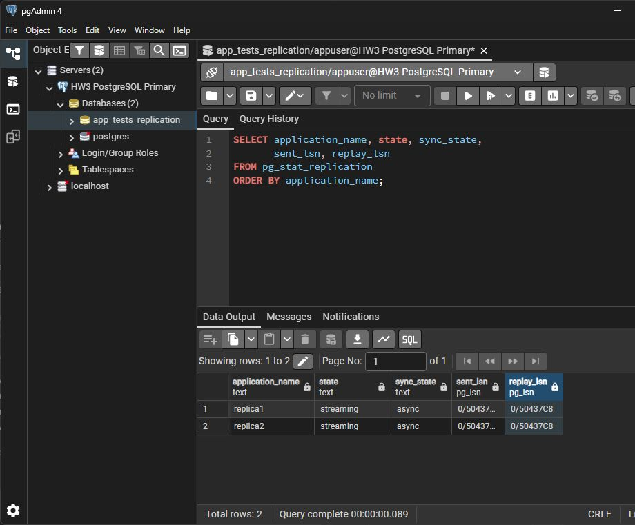
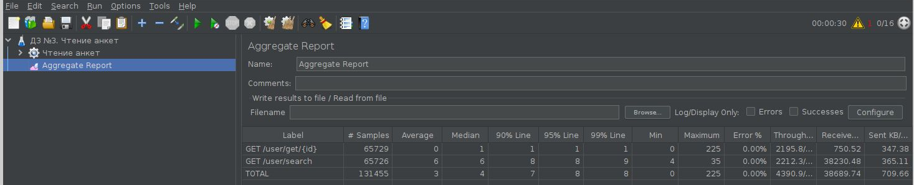
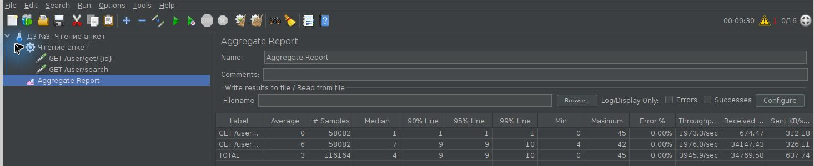
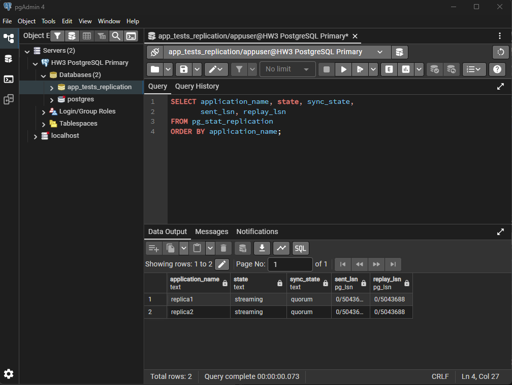

# ДЗ №3. Репликация PostgreSQL

- [Условия OTUS](https://otus.ru/events/highload_ol2/511/).
- [Репозиторий исходного кода](https://github.com/stre4m/highload-course).
- [Compose](../../infrastructure/homework-3/compose.yaml), [план JMeter](../../scripts/replication-reads.jmx).

## Ручная демонстрация

Для запуска нужен свободный порт 5084. Команды выполняются в новом окне PowerShell. Имя лабораторного проекта, порт и адрес primary заданы в `compose.yaml`. При первом запуске вводится пароль лабораторной базы. При повторном запуске с теми же томами вводится действующий пароль.

~~~powershell
cd infrastructure/homework-3
$env:HW3_POSTGRES_PASSWORD = Read-Host 'Пароль лабораторного PostgreSQL' -MaskInput
podman compose up -d primary
~~~

Готовность PostgreSQL проверяется отдельными командами. API запускается после успешного SQL-запроса.

~~~powershell
podman compose exec primary pg_isready -h 127.0.0.1 -U appuser -d app_tests_replication
podman compose exec primary psql -U appuser -d app_tests_replication -c 'SELECT 1'
podman compose up -d --build api
~~~

При проверке готовности ожидаются `accepting connections` и результат `1`. Через Swagger UI на `http://127.0.0.1:5084/swagger/index.html` регистрируется тестовая анкета. Полученный UUID используется для GET по ID, а префиксы имени и фамилии — для поиска. На этом этапе оба GET читают primary.

~~~powershell
podman compose up -d replica1 replica2
podman compose exec -T primary psql -X -U appuser -d app_tests_replication -c 'SELECT application_name, state, sync_state FROM pg_stat_replication ORDER BY application_name'
$env:HW3_POSTGRES_READ = 'Host=replica1,replica2;Database=app_tests_replication;Target Session Attributes=standby;Load Balance Hosts=true'
podman compose up -d --force-recreate api
~~~

Перед повтором запросов нужно дождаться `streaming` для обоих узлов. Значение `async` показывает исходный режим репликации. Для проверки распределения выполняется запрос счётчика на каждом узле до и после серии GET. Вместо `replica1` подставляется имя проверяемого сервиса.

~~~powershell
podman compose exec -T replica1 psql -XAt -U appuser -d app_tests_replication -c "SELECT seq_scan + idx_scan FROM pg_stat_user_tables WHERE relname = 'users'"
~~~

PostgreSQL публикует статистику асинхронно. После серии запросов счётчик проверяется с небольшой паузой. После завершения демонстрации `podman compose stop` останавливает только этот проект. Ручная демонстрация проверяет прохождение запросов.

## Настройка PostgreSQL

В Compose заданы три сервиса PostgreSQL 17: `primary`, `replica1` и `replica2`. У каждого свой том. Реплики подключаются к `primary:5432` по внутренней сети Compose.

Значения параметров primary. Compose передаёт их процессу `postgres` через `-c`.

~~~conf
wal_level = replica
max_wal_senders = 10
wal_keep_size = 128MB
~~~

`wal_level` определяет уровень детализации WAL. `max_wal_senders` ограничивает число процессов отправки WAL. `wal_keep_size` задаёт минимальный объём старых сегментов WAL, сохраняемых для отстающих реплик.

При первой инициализации primary в `pg_hba.conf` добавляется правило для лабораторной роли `appuser`.

~~~conf
host replication appuser all scram-sha-256
~~~

При первом запуске каждая реплика создаёт физическую копию primary. `REPLICA_NAME` имеет значение `replica1` или `replica2`.

```sh
pg_basebackup --pgdata="$PGDATA" --write-recovery-conf --wal-method=stream --checkpoint=fast \
    --dbname="host=primary port=5432 user=$POSTGRES_USER application_name=$REPLICA_NAME"
```

`--write-recovery-conf` создаёт `standby.signal` и записывает `primary_conninfo`. При старте PostgreSQL видит `standby.signal`, подключается к primary и применяет поступающий WAL. После первого запуска реплика использует свой существующий том.

Результат запроса к `pg_stat_replication` перед переключением чтения.

```text
application_name |   state   | sync_state
replica1         | streaming | async
replica2         | streaming | async
```

`streaming` подтверждает, что primary передаёт WAL на обе реплики. `async` означает, что в фазе чтения фиксация транзакции на primary не ждёт подтверждения от реплики. Для опыта с отказом отдельно включён синхронный кворум.

### Проверка в pgAdmin

Для подключения pgAdmin порт primary опубликован на `127.0.0.1:15438`. В **Register → Server** указаны база `app_tests_replication` и роль `appuser`. Проверка проведена на отдельном лабораторном стенде.

В **Query Tool** на primary выполнен запрос. `sent_lsn` показывает отправленную позицию WAL, `replay_lsn` — позицию, уже применённую репликой.

~~~sql
SELECT application_name, state, sync_state, sent_lsn, replay_lsn
FROM pg_stat_replication
ORDER BY application_name;
~~~



## Маршрутизация API

```text
POST /user/register                 ──→ primary
POST /login и GET /user/me          ──→ primary
                                        ├── WAL ──→ replica1
                                        └── WAL ──→ replica2
GET /user/get/{id} и /user/search   ──→ replica1 или replica2
```

В исходном режиме все операции используют `ConnectionStrings__Postgres`. Во второй фазе `ConnectionStrings__PostgresRead` перечисляет обе реплики. Npgsql распределяет соединения между ними и выбирает серверы в режиме standby. Регистрация в этом режиме записала анкету на primary. Затем её UUID стал доступен на обеих репликах.

## Замеры чтения в JMeter

В плане одна `Thread Group` и два `HTTP Request`. Каждый поток последовательно выполняет GET по UUID и поиск по двум префиксам. Оба запроса используют HTTP keep-alive.

1. Открыть [план](../../scripts/replication-reads.jmx) через **File → Open** в JMeter. В дереве раскрыть группу потоков. В первом запросе UUID входит в путь. Во втором префиксы передаются в параметрах `first_name` и `last_name`.
2. Для пробного запуска в GUI указать один поток, UUID существующей анкеты и её префиксы. Временно добавить **View Results Tree**. Проверить статус 200, объект анкеты и непустой массив поиска. Для замера открыть исходный план.
3. Выполнить первый замер при пустом `HW3_POSTGRES_READ`. Запустить реплики, дождаться `streaming`, задать строку чтения и пересоздать API. Повторить замер с теми же анкетами и параметрами.

Пример запуска из корня репозитория. Если JMeter отсутствует в `PATH`, команду `jmeter` заменить полным путём до исполняемого файла. Значение `-Jhost` должно быть доступно с машины, где запускается JMeter. Для повтора используются новые файлы JTL и пустые каталоги отчётов.

~~~text
jmeter -n -t scripts/replication-reads.jmx -Jhost=127.0.0.1 -Jport=5084 -JprofileId=UUID -JfirstName=Name0001 -JlastName=Surname000 -Jthreads=16 -Jramp=5 -Jduration=30 -l primary.jtl -e -o primary-report
~~~

`UUID` заменяется идентификатором тестовой анкеты. Для второго замера параметры нагрузки сохраняются, а выходные имена меняются на `replicas.jtl` и `replicas-report`. Флаг `-n` отключает GUI, `-l` сохраняет результаты запросов, `-e -o` строит HTML Dashboard. Для просмотра открывается файл `index.html` в каталоге отчёта.

## Результаты ручного запуска в JMeter

Обе фазы выполнены в JMeter с одинаковыми настройками. 16 потоков, разгон 5 секунд, длительность 30 секунд. Результаты сняты из **Aggregate Report**.

### Повторение в JMeter GUI

1. Через **File → Open** открыть план. В **Thread Group** проверить число потоков, время разгона и длительность.
2. Раскрыть оба **HTTP Request**. Для запуска без параметров CLI указать UUID в пути первого запроса, а префиксы имени и фамилии — в **Parameters** второго.
3. В дереве плана выбрать **Add → Listener → Aggregate Report**. Для сохранения сырых результатов указать новый файл в поле **Filename** слушателя перед запуском. Нажать **Start**. После окончания в правом верхнем углу отображается `0/16`.
4. Переключить API на реплики. Запустить второй прогон с теми же настройками. Для второго прогона используется отдельный слушатель или новый запуск с очищенной таблицей и другим именем JTL.

В обеих фазах использовалась база из 100 000 синтетических анкет с индексом поиска. GET получал анкету `c4ca4238-a0b9-2382-0dcc-509a6f75849b`. Поиск использовал префиксы `Name0001` и `Surname000`.

**Чтение через primary**



**Чтение через две реплики**



| Режим | Запрос | Запросов | Ошибки | Запросов/с | p50, мс | p95, мс | p99, мс |
|---|---|---:|---:|---:|---:|---:|---:|
| Primary | `GET /user/get/{id}` | 65 729 | 0% | 2195,8 | 1 | 1 | 1 |
| Primary | `GET /user/search` | 65 726 | 0% | 2212,3 | 6 | 8 | 9 |
| Реплики | `GET /user/get/{id}` | 58 082 | 0% | 1973,3 | 1 | 1 | 1 |
| Реплики | `GET /user/search` | 58 082 | 0% | 1976,0 | 7 | 9 | 10 |

В **Aggregate Report** колонка `# Samples` содержит число запросов, `Error %` — долю ошибок, `Median`, `95% Line` и `99% Line` — процентили полного времени ответа. Строка `TOTAL` показала 131 455 запросов и 4390,9 запроса/с на primary, 116 164 запроса и 3945,9 запроса/с на репликах. Изменение составило `(3945,9 / 4390,9 − 1) × 100 ≈ −10,13%`. Все узлы работали на одном компьютере.

### Архив проверки маршрутизации

В отдельном предыдущем прогоне JMeter через CLI счётчики PostgreSQL показали прирост 0 на primary, 55 375 на первой реплике и 55 124 на второй. Архив этой проверки содержит [JTL](jmeter/reads-jtl.zip), [Statistics primary](jmeter/primary-statistics.json) и [Statistics реплик](jmeter/replicas-statistics.json).

Сводки этого прогона доступны на скриншотах [primary](jmeter/primary-dashboard.png) и [реплик](jmeter/replicas-dashboard.png).

## Синхронный кворум и отказ

Эта часть относится к отдельному контрольному прогону записи через `psql`. План JMeter выше проверяет чтение.

1. На primary заданы `synchronous_commit=on` и `synchronous_standby_names='ANY 1 (replica1, replica2)'`. Подтверждение COMMIT ожидает сохранения WAL на диске хотя бы одной реплики. Обе реплики перешли в состояние `streaming|quorum`.
2. Четыре клиента выполняли одиночные `INSERT` в `hw3_writes` с уникальными UUID. Клиент добавлял UUID в журнал после успешного завершения `psql`.
3. После 24 подтверждений сценарий отправил `SIGKILL` контейнеру primary. По итогам нагрузки учтено 32 попытки. Клиент получил 27 подтверждений. Пять попыток остались без подтверждения.
4. Обе реплики применили WAL до `0/702A730`. При равенстве выбрана `replica1`. После `pg_promote` параметр `primary_conninfo` второй реплики направлен на новый primary. Она вернулась в состояние `streaming|quorum`.
5. Все 27 подтверждённых UUID найдены на новом primary. Пропущенных UUID и записей без подтверждения в таблице оказалось 0. Отдельная контрольная запись на новом primary появилась на второй реплике.

Переключение выполнялось сценарием через SQL. Восстановление HTTP-записи после смены primary в замер не входило. Результат относится к отказу одного узла при сохранении обеих реплик.

На стенде pgAdmin кворум включён командами ниже. После перечитывания настроек выполнен тот же запрос к `pg_stat_replication`, что и в разделе «Проверка в pgAdmin». В колонке `sync_state` у обеих реплик значение изменилось с `async` на `quorum`. Испытание отказа выполнено в отдельном прогоне.

~~~sql
ALTER SYSTEM SET synchronous_standby_names = 'ANY 1 (replica1, replica2)';
SELECT pg_reload_conf();
~~~



### Как проверить вывод об отказе

| Что проверяется | Источник и расчёт |
|---|---|
| Кворум перед отключением | `SHOW synchronous_commit` и `SHOW synchronous_standby_names` на primary показывают `on` и `ANY 1 (replica1, replica2)`. В `pg_stat_replication` обе строки имеют состояние `streaming` и `sync_state = quorum`. |
| Выбор узла для повышения | На каждой реплике запрос `SELECT pg_last_wal_receive_lsn(), pg_last_wal_replay_lsn()` показывает полученную и применённую позиции WAL. После их совпадения на каждом узле сравниваются позиции между узлами. При равенстве `0/702A730` сценарий выбрал `replica1`. |
| Переключение второй реплики | После `pg_promote` на выбранном узле параметр `primary_conninfo` второй реплики указывает на него. Строка `replica2 / streaming / quorum` в `pg_stat_replication` нового primary подтверждает подключение. |
| Потери подтверждённых операций | Журнал клиента содержит UUID только после успешного завершения `psql`. На новом primary команда `SELECT id FROM hw3_writes ORDER BY id` получает сохранённые UUID. Потери равны разности «UUID из журнала минус UUID из таблицы». В прогоне журнал содержит 27 уникальных UUID, а `missing_acknowledged_ids` пуст. Полный список строк нового primary отдельно не экспортировался. |
| Операции без подтверждения | Всего 32 попытки. Из них `32 − 27 = 5` без подтверждения. Обратная разность «UUID из таблицы минус UUID из журнала» тоже пуста. |
| Запись на новом primary | Контрольная запись имеет UUID `ca2512a1-0715-459b-886b-c3f6d71ae601`. Его наличие проверено запросом к `hw3_writes` на второй реплике, уже подключённой к новому primary. |

### Данные проверки отказа

- [Позиции WAL, состояние кворума и сверка UUID](failover.json).
- [Журнал подтверждённых записей](acknowledged.txt).
