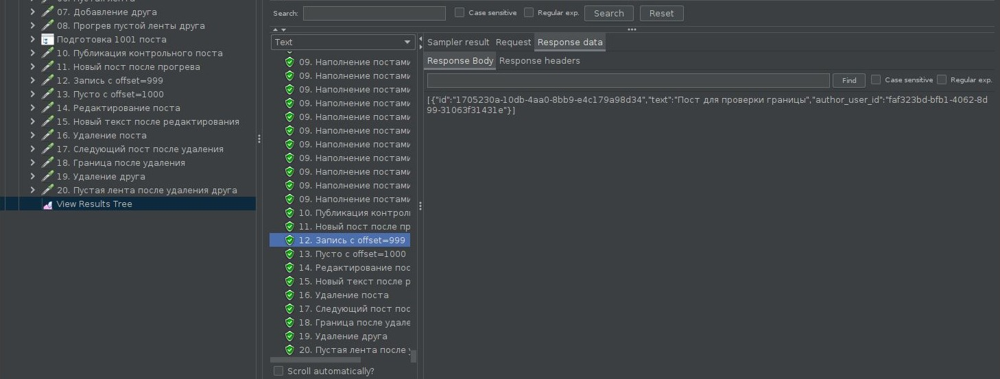
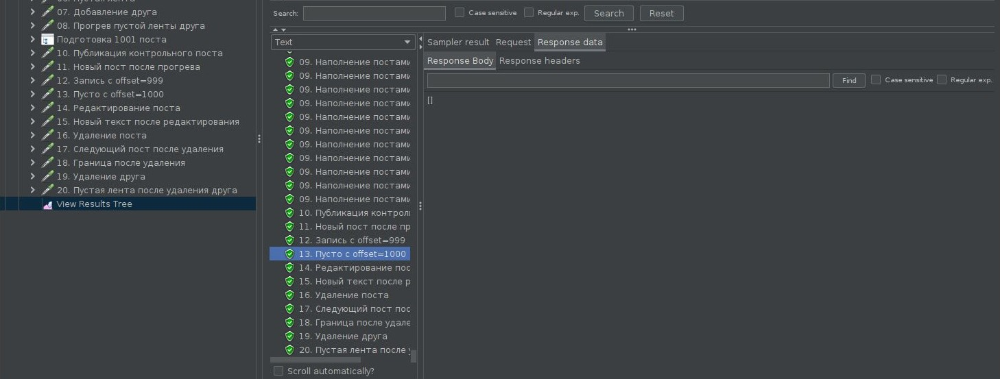
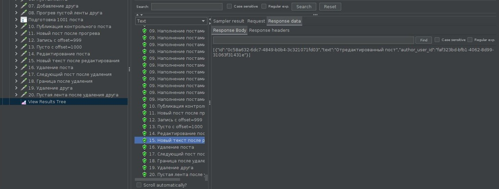
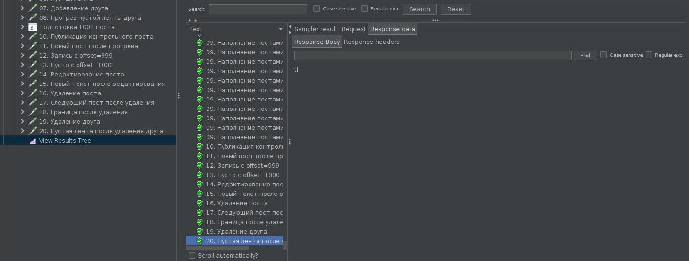
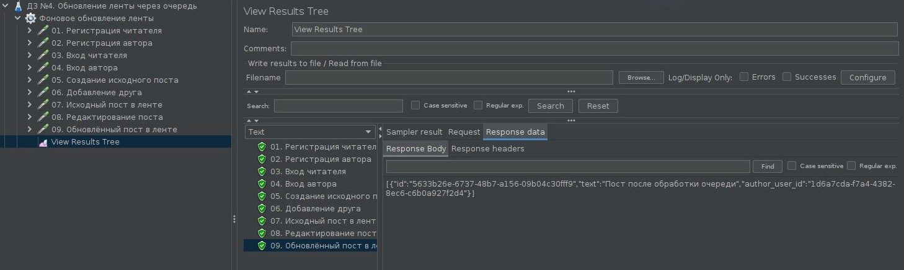

# ДЗ №4. Кеширование ленты друзей

## Как устроен кеш

В [`FeedCache`](../../src/SocialNetwork/FeedCache.cs) оба вида снимков хранятся в `MemoryCache` внутри процесса API.

- Снимок автора хранится по UUID автора. Это список до 1000 последних `StoredPost`. Каждый элемент содержит UUID поста, текст, UUID автора и время создания. Время нужно для сортировки при сборке ленты.
- Снимок ленты хранится по UUID пользователя. Это готовый массив из максимум 1000 объектов `Post` с UUID поста, текстом и UUID автора. При попадании в кеш `GET /post/feed` берёт из массива страницу по `offset` и `limit` без запроса к PostgreSQL.

При промахе приложение читает список друзей и загружает из PostgreSQL посты авторов, которых ещё нет в кеше. Затем объединяет посты друзей в памяти, оставляет 1000 самых свежих и сохраняет готовую ленту.

Создание, редактирование или удаление поста сбрасывает кеш автора и ленты его подписчиков. При добавлении или удалении друга сбрасывается лента пользователя. Ранее кешированные ленты ставятся во внутреннюю очередь на фоновую сборку. Если запрос приходит раньше обработки очереди или API только что перезапустился, лента собирается при чтении.

[Подробности реализации](../decisions/0004-friend-feed-cache.md).

## Результат проверки в JMeter

План [homework-4.jmx](../../scripts/homework-4.jmx) создал 1002 поста для проверки лимита и инвалидации кеша. JMeter выполнил 1020 запросов без ошибок проверок. Запрос без токена вернул ожидаемый `401`.

1. При `offset=999&limit=1` возвращается последняя запись из кешируемой тысячи.

   

2. При `offset=1000&limit=1` возвращается пустой массив, хотя у автора больше 1000 постов.

   

3. После редактирования контрольного поста следующий запрос ленты возвращает новый текст. После удаления поста его место занимает следующая запись.

   

4. После удаления единственного друга лента возвращает пустой массив.

   

## Повторение проверки

Из корня проекта запустить отдельный стенд. Требуются JMeter, Docker Compose и [файл `.env`](../../README.md#настройка).

```powershell
$env:POSTGRES_DB = 'app_tests_hw4'
$env:POSTGRES_HOST_PORT = '54804'
$env:API_HOST_PORT = '5084'
docker compose --env-file .env -p social-network-hw4 -f infrastructure/compose.yaml up -d --build
```

Проверить готовность PostgreSQL.

```powershell
docker compose -p social-network-hw4 -f infrastructure/compose.yaml exec postgres pg_isready -h 127.0.0.1
```

Проверить таблицы в `psql`. Если в `.env` задана другая роль, заменить `appuser`.

```powershell
docker compose -p social-network-hw4 -f infrastructure/compose.yaml exec postgres psql -U appuser -d app_tests_hw4
```

```sql
\dt
\q
```

В JMeter на хосте открыть `scripts/homework-4.jmx` через **File → Open**. План по умолчанию обращается к `127.0.0.1:5084`. Нажать **Start** и открыть **View Results Tree**. Для просмотра JSON выбрать запрос и открыть **Response data**. Повторный запуск создаёт новые тестовые профили и посты.

## Проверка обновления через очередь

В отдельном [плане JMeter](../../scripts/homework-4-queue.jmx) лента была открыта до редактирования поста. После редактирования в журнале API появилась запись `Feed refreshed from queue`. PostgreSQL остановили до следующего запроса. Лента вернула `200` и пост с новым текстом. Это подтверждает, что обработчик очереди обновил кеш до чтения.



### Повторение проверки очереди

Открыть план `scripts/homework-4-queue.jmx` в JMeter. В шаге **09. Обновлённый пост в ленте** открыть **Constant Timer** и установить `45000` мс. Пауза даёт время остановить PostgreSQL после шага 08.

Нажать **Start** и открыть **View Results Tree**. После успешного запроса **08. Редактирование поста** проверить журнал API. Запись `Feed refreshed from queue` для текущей ленты должна появиться перед запросом 09.

```powershell
podman logs --tail 20 social-network-hw4-api-1
```

Остановить только тестовый PostgreSQL и проверить состояние контейнера.

```powershell
podman stop social-network-hw4-postgres-1
podman inspect --format '{{.State.Status}}' social-network-hw4-postgres-1
```

Проверить код `200` для запроса **09. Обновлённый пост в ленте**. На вкладке **Response data** проверить исходный UUID поста и текст `Пост после обработки очереди`. После проверки запустить PostgreSQL, дождаться готовности и перезапустить API для сброса соединений.

```powershell
podman start social-network-hw4-postgres-1
podman exec social-network-hw4-postgres-1 pg_isready -h 127.0.0.1
podman restart social-network-hw4-api-1
```

## Восстановление кеша из PostgreSQL

После перезапуска API запрос `GET /post/feed?limit=1000` вернул те же 1000 постов в том же порядке. Ответ сравнили с сохранённым снимком ленты.

Для повтора в Swagger сохранить ответ этого запроса, перезапустить API командой из предыдущего раздела и получить новый токен через `POST /login`. Повторить запрос ленты и сравнить ответы.
